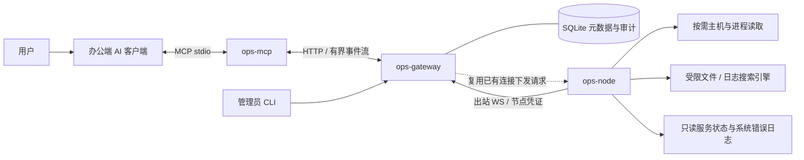

# Rust 通用服务器诊断子 agent：架构设计

更新日期：2026-10-21。

本文是项目唯一的架构与功能契约，定义完整目标系统，不按产品版本拆分功能。范围聚焦通用 Linux 机器信息、进程/只读服务状态、授权文件和日志取证；Doris、Kafka 等产品专有接口、凭证和诊断规则不在交付范围。项目入口见 [README](../README.md)，按开发依赖排序的实施、审查和验收见 [任务明细](TASKS.md)。

目前项目只有设计文档，没有 Rust 工程、可执行程序或实机性能结果。本文的功能是最终应实现的要求，数值是待实际环境验证的运行参数，均不能当作已经实现或通过测试的能力。

## 1. 系统解决什么问题

系统定位为办公端 AI 的受控远程诊断通道。用户用自然语言提出问题，AI 选择工具，服务器本地子 agent 获取机器状态与文件/日志证据，AI 根据带来源和范围的结果进行分析。子 agent 是按需执行工具的轻量程序，不在服务器上运行模型或自主反复探索。即使目标机器安装了数据库或消息队列，也只通过通用机器信息与授权日志进行排查。

| 当前痛点 | 最终解决方式 |
| --- | --- |
| 内网机器不能从办公电脑直接访问 | 节点主动出站连接网关，网关通过既有连接转发请求 |
| 需要逐台 SSH、拼命令、复制日志 | AI 通过固定工具查询节点、主机、进程、服务、文件和日志 |
| 大日志不能全部搬到办公电脑或模型 | 节点本地搜索，仅返回有界命中、上下文与覆盖说明 |
| 持续采集和索引会占用业务机器资源 | 按需读取；不用模型时没有主机指标采样、日志扫描或索引任务 |
| 搜索没查完却被当成“没有问题” | 请求终态、已检查范围、未检查范围和未知状态分别表达 |
| 日志轮转、乱码、压缩导致上下文不可靠 | 文件身份绑定、字节域、流式解码和解压、事件引用与变化检测 |
| 给 AI 广泛服务器权限难控制 | 固定只读工具、节点本地目录白名单、用户授权、配额和审计 |
| 出现连不上、权限不对时难定位 | 明确代理状态、凭证有效状态、能力、错误原因与管理工具 |

这套系统提供当前可取得的诊断证据。历史趋势和自动告警由现有监控平台承担；没有保存下来的日志或采样数据不能事后还原。任意 Shell、文件写入、服务启停、进程处置和自动修复不在最终功能范围内。

## 2. 最终整体架构



### 2.1 三个程序与共享库

| 组件 | 完整职责 |
| --- | --- |
| ops-node | 节点身份、连接、二次授权、本地配额、机器/进程/服务状态、文件与系统日志、解压解码、查询状态与取消 |
| ops-gateway | 用户认证、授权、节点发现、连接归属、多节点调度、预算分配、流式转发、审计、凭证管理 |
| ops-mcp | MCP 工具与 schema、办公凭证、HTTP 调用、取消、模型输出预算、结构化结果和简明摘要 |
| ops-protocol | 消息、配置类型、工具契约、身份与版本字段、错误码、预算和覆盖语义 |

节点不运行模型。网关不集中收集和索引业务日志。每台办公电脑按客户端需要启动一个桥接进程。管理员 CLI 由 ops-gateway 的管理子命令提供，无需另建管理网站。

实现使用 Rust workspace；网络为 Tokio、Axum 和 tokio-tungstenite，协议/配置为 Serde、JSON/TOML，MCP 为 rmcp，搜索为字面匹配与 regex，编码和压缩使用受限流式库。依赖锁定经过完整构建验证的稳定版本及必要 features，原生库与目标 libc 一并进入发布兼容矩阵。

默认直接以 IP 和端口访问：办公端使用 `http://<GATEWAY_IP>:<PORT>`，节点使用同一监听器上的 `ws://<GATEWAY_IP>:<PORT>`。地址和监听端口均可配置，不要求域名、HTTPS、TLS 证书或 mTLS，也不把反向代理作为部署前提。

办公请求携带用户凭证，节点在 WS 升级握手中携带独立节点凭证；网关验证凭证类型、绑定节点、有效期和撤销状态后才接受相应请求。普通 node_id/身份请求头不能替代认证，用户令牌不能充当节点身份；凭证不放在 URL 查询串。

本部署依赖受控网络和防火墙限制允许的办公端、节点及管理来源。防火墙提供入口控制，HTTP/WS 本身不加密，也不提供 TLS 服务端身份验证；凭证与查询片段按该边界传输。这个取舍不改变应用层身份、授权、脱敏、配额和审计要求。

### 2.2 项目目录与职责边界

```text
rust-ops-agent/
├── README.md
├── docs/
│   ├── ARCHITECTURE.md        # 本文：完整架构与功能契约
│   └── TASKS.md               # 按开发顺序的任务与验收
├── crates/
│   ├── ops-protocol/          # 共享类型、版本、错误与预算语义
│   ├── ops-node/              # Linux 读取、搜索与节点连接
│   ├── ops-gateway/           # HTTP/WS、授权、调度、SQLite、管理 CLI
│   └── ops-mcp/               # MCP stdio 与办公端 HTTP 客户端
├── configs/
│   ├── examples/             # 无真实身份与秘密的配置样例
│   └── local/                # 真实配置，本地忽略
├── deploy/systemd/           # 服务单元与资源约束样例
├── scripts/                  # 构建、安装、发布和测试辅助脚本
└── tests/
    ├── integration/          # 计划中的独立测试 workspace member
    ├── e2e/                  # 真实调用链及故障验收
    ├── fixtures/             # 小型、可公开、已知结果样本与生成规范
    └── performance/          # 完整程序资源与性能测量
```

当前只创建空目录骨架；Cargo 清单与源码在任务 T01 中建立。crate 内部各自管理 `src/`、单元测试和局部模块；`tests/integration` 在 T01 创建独立 Rust 测试包并接入 workspace，其余顶层测试通过明确脚本/入口执行，虚拟 workspace 不会自动发现根目录测试。`ops-protocol` 不依赖另外三个业务 crate；节点不依赖办公端或网关实现。

运行凭证、数据库、真实日志、生成大样本及原始测试证据统一放在被忽略的 `.local/`，真实配置放在被忽略的 `configs/local/`。正式部署使用仓库外受限服务目录。`findings.md`、`progress.md`、`task_plan.md` 仅供本地工作记录并被忽略；公开文档只保留 README、本文和任务明细，不能把真实环境数据提交到仓库。

### 2.3 部署与可用性定案

按目前已知的按需诊断需求，推荐正式部署采用单活网关、SQLite WAL、systemd 自动恢复、独立介质备份和可复现的恢复流程。SQLite 的事务和审计写入经有界执行通道完成，不能阻塞网络事件循环。数据库与备份不保存业务日志正文。

这是完整功能系统的部署取舍：网关进程崩溃后恢复接入，网关主机故障时诊断服务会中断，需要恢复主机或迁移部署；在途查询返回中断，不承诺无缝续跑。当前材料没有给出不中断服务的要求，因此不凭空增加分布式依赖。节点规模和承载量以完整功能压测结果为准。

如果可用性要求包含“任意一台网关主机故障后自动恢复接入”，部署拓扑应直接选择负载均衡、两台网关和高可用 PostgreSQL。节点仍维持一条 WS，数据库事务记录连接拥有者和会话代数，办公请求由接收网关通过内网流式 RPC 转给连接拥有者；结果不进入数据库，Redis 没有必要职责。数据库本身也需要高可用。这个选择取决于可用性要求，与功能版本无关；不得把共享 SQLite 文件或直接增加副本当作高可用。

在没有进一步可用性要求时，本文其余部分采用单活网关拓扑。

### 2.4 SQLite 的作用与存储范围

SQLite 是网关的管理状态和审计存储，使重启后仍能识别节点、验证身份和恢复授权规则；它不是业务日志库、历史监控库或查询结果缓存。按以下逻辑表组设计，物理 schema 由迁移脚本维护：

| 表组 | 持久化内容 |
| --- | --- |
| 节点与分组 | node_id、显示名、标签/分组、启停状态、登记信息；可保存最近观察时间，但不能据此认定在线 |
| 用户、角色与授权 | 用户/角色关系、节点/工具/目录/服务/日志源授权、范围限制和授权修订 |
| 办公用户令牌 | 公共标识、不可逆校验材料、期限、权限范围、撤销状态；不保存令牌明文 |
| 节点访问凭证 | 绑定 node_id、凭证公共标识、不可逆校验材料、有效期、轮换与撤销状态；与用户令牌区分，不保存原文 |
| 配置和安全修订 | 适用于网关的策略修订、变更记录、撤销事实和受限恢复状态；节点真实路径以本机配置为准 |
| 审计 | 调用者、目标别名、工具、请求 ID、授权修订、时间、结果、耗时、用量及管理操作；不保存返回正文 |
| 数据库维护 | schema 版本、迁移和备份恢复所需元信息 |

当前在线连接、心跳状态、执行队列、请求转发状态与短期游标放在有界内存中；节点保存自己的有界文件/解压执行状态。网关或节点重启会中断在途工作并使相关游标失效，不从 SQLite 自动重放。主机状态、文件正文、搜索命中和 CPU 等采样结果只在有界传输/处理内存中存在。

用户和节点凭证由管理员通过受限本机流程生成或轮换；使用高熵随机值，原文只写入持有方受限文件，SQLite 保存校验材料。登记、凭证轮换和撤销必须具备事务边界，避免并发更新留下不一致身份。数据库写入由有界工作通道执行；查询开始先建立审计事实，结束更新结果，进程异常遗留状态标记中断而非成功。

### 2.5 节点内部执行模型

网络使用 Tokio current_thread；长搜索和解压使用专用有界执行通道，短文件读取与主机读取有明确调度通道。请求准入先取得配额，之后才创建任务；不能先创建无限任务再等待信号量。

心跳、取消和权限撤销拥有保留的控制消息处理能力。网络读写解耦，单帧与发送等待有上限；同一 TCP 连接出现拥塞时，控制消息优先级不能消除底层阻塞，应在无进展超时后关闭会话并停止工作。慢搜索不能让主机状态请求无限排队。

阻塞 IO 不具备可靠的强制取消保证。执行通道长时间无进展时，节点应报告“连接在线、文件通道降级”，停止接收相应工作；仍应尽可能提供不依赖该通道的查询。所有底层库线程、认证、解压器和系统日志接口均纳入完整程序资源测量。[Tokio 官方文档](https://docs.rs/tokio/latest/tokio/task/fn.spawn_blocking.html)确认已开始的阻塞任务不能通过 abort 中止，current_thread 也不意味着进程只有一个线程。

## 3. 身份、权限与数据控制

### 3.1 节点和用户身份分开

- 管理员预登记固定 node_id，为每个节点发放独立、有限期、可撤销的高熵访问凭证，禁止匿名自动注册。节点不开放公网诊断端口。
- 节点在 WS 握手中提交凭证，网关将验证结果绑定会话，hello 中的节点 ID 必须与凭证一致；不能信任未验证的身份请求头。
- 办公用户采用独立、有权限范围的令牌，不能替代节点凭证。两类凭证从系统凭证存储或受限配置读取，不经 URL/命令行明文传入，不写入日志。
- 管理 CLI 支持凭证发放、到期提示、短时重叠轮换和撤销；撤销节点凭证同时关闭关联会话，旧凭证不得重连。
- 不要求 PKI、CSR、证书签发/续期或企业登录；连接可达性由部署时配置的防火墙与网络策略约束。
- 节点本地单实例锁；网关记录实例/启动标识和会话代数。正常重连可替换旧会话，重复身份冲突要有确定仲裁和审计。

### 3.2 授权和变更语义

权限粒度为用户/角色、节点/节点组、工具、目录别名、服务范围及系统日志源别名。节点组与选择条件在请求开始时固定成授权节点集合，执行中新增节点不会自动加入。

网关是可信授权中心，节点根据网关下发的授权范围和本机白名单再次取交集。网关可以看到返回片段，架构不提供办公端到节点的端到端保密；需要按这个信任边界部署和管理网关。

每次请求及续查校验当前授权修订。管理员撤销后，新请求和未下发队列立即拒绝；网关停止继续转发受影响请求的正文并发出取消；节点身份撤销还应关闭现有会话并拒绝重连。已发出的网络字节无法收回，节点内阻塞任务的停止延迟单独记录。

配置采用修订号。目录根或解析规则变化时，旧游标失效；已开始请求不得悄悄切到新目录。正式支持“校验后原子应用配置，或通过服务重启应用”的明确操作流程；预算和权限收紧要取消不符合新约束的工作。

### 3.3 数据范围与脱敏

默认没有可读目录，逐项配置真实日志目录和操作权限。目录边界控制能读什么，脱敏规则控制能发出什么；只读访问同样可能暴露敏感内容。

脱敏在节点出站前统一应用于读取、尾部、搜索上下文、系统日志及服务状态文本。输出标明 redacted，证据位置仍引用原始数据字节域；不把脱敏文本中的位置当作源文件偏移。需要强制脱敏的目录禁止原始字节/Base64 读取；只有明确允许原文输出的目录和独立权限才开放原始读取。规则失败时返回明确错误，不降级成发送原文。

所有组件默认不把正文、完整搜索条件、用户或节点凭证写入诊断日志和 HTTP trace。审计保留调用者、目标别名、工具、请求 ID、授权修订、时间、用量和结果，敏感参数按策略脱敏或摘要化。

## 4. 查询协议与生命周期

办公端使用 HTTP 有界 NDJSON 事件流；节点使用 WS 复用请求。协议主版本不兼容时拒绝，次版本增加兼容字段；工具按实际能力及其版本校验，不能把未配置或不可访问的系统能力伪装成可用。

消息包含 hello、request、accepted、chunk、terminal、cancel 和控制心跳。所有业务消息绑定 node_id、session_generation、request_id，chunk 带递增序号。请求 ID 由可信端生成，并在相应会话和调用者范围内去重；不自动重放已经开始的查询。

正常状态为 queued → running → succeeded/partial/failed/cancelled。仍可写的正常事件流对每个请求只发送一个 terminal，此后禁止继续发送正文。网络故障可能使终结事件无法送达；接收端缺少 terminal 时必须自行标记 interrupted，保留已收到结果但不能认定查完。

“请求结束”与“搜索查全”分别表达：

```json
{
  "request_id": "q-001",
  "node_id": "node-01",
  "query_status": "partial",
  "coverage": {
    "exhaustive": false,
    "scope": "frozen_candidates_and_byte_ranges",
    "stop_reasons": ["scan_budget_exhausted"],
    "files_planned": 12,
    "files_checked": 3,
    "files_failed": 0,
    "details_truncated": false
  },
  "usage": {
    "covered_source_bytes": 65000000,
    "application_read_bytes": 67108864,
    "decoded_bytes": 65000000,
    "returned_bytes": 18000
  },
  "next_cursor": "opaque-reference"
}
```

这是说明语义的示例，正式 schema 还需定义各字段类型和上限。空结果只有在已声明范围 exhaustive=true 且无未判定部分时，才能表示“该范围无匹配”；尾部窗口查全不代表整文件查全。

预算包括候选枚举、排队、读取、解压、匹配、返回、等待下游和总耗时。各端使用单调计时，转发剩余预算，不能每经过一层重新获得完整超时。排队过期的请求不再执行。

终结元信息与游标预留独立输出空间。多项限制同时触发时保留主要停止原因和辅助原因；错误明细本身也分页或截断，不能无界增长。MCP 汇总不能丢掉这些信息。

标准错误覆盖 OFFLINE、BUSY、UNAUTHORIZED、CAPABILITY_UNAVAILABLE、CONFIG_CHANGED、FILE_CHANGED、CURSOR_EXPIRED、CONNECTION_LOST、TIMEOUT、UNSUPPORTED_FORMAT 和 INVALID_ARGUMENT 等类别；业务错误、部分结果和 MCP 协议错误分别映射。按照 [MCP 工具规范](https://modelcontextprotocol.io/specification/2025-11-25/server/tools)提供输入/输出 schema、结构化结果及兼容文本内容，所有实际输出表示都计入大小预算。

## 5. 通用机器、进程、服务与系统错误

工具将相对稳定的机器信息与需要采样的运行状态分开；所有字段都有单位、来源、观察时间和可用性说明。

| 工具 | 返回内容与用途 |
| --- | --- |
| host.info | 主机名、发行版、内核、架构、启动标识/时长；CPU 型号、可见物理核/逻辑核、在线核数；内存总量及可见硬件信息。虚拟机/容器可见拓扑注明范围，未知字段不猜测 |
| host.status | 总体/分核 CPU 使用率、user/system/iowait/steal、load、可用内存/swap、按需系统压力（内核可用时）；区分运行计数与采样速率 |
| host.disks | 块设备/分区与已知挂载关系、容量、文件系统、总量/可用量、inode、只读状态；磁盘读写吞吐/IOPS/等待与队列等可推导统计，标明采样窗口与语义 |
| host.network | 网卡状态/地址、收发字节/包、错误/丢包和按需速率；有界监听端口信息在权限允许时返回，不做任意目标探测或端口扫描 |
| processes.list / processes.inspect | 有界进程枚举、CPU/内存/线程/状态及允许的 IO/FD 摘要；用于关联哪个进程占用资源或异常退出 |
| services.list / services.inspect | systemd 服务加载/运行状态、失败结果、主 PID、退出码/信号、重启计数及可得时间；通过只读 D-Bus 属性和列表接口获取 |
| logs.system | 从授权 journald 或配置的 syslog/kern.log 等文本日志中，按启动、时间、服务、级别和关键词查询系统错误；覆盖 OOM、段错误、IO 错误、文件系统错误和服务失败的可得证据 |

CPU/磁盘/网络速率在同一请求内两次采样，初始间隔可设 500 ms，并返回实际采样区间。CPU 硬件型号不依赖采样。磁盘空间用尽、inode 用尽和设备 IO 繁忙分别判断；不能仅凭 iowait 或设备 busy 推断硬件故障。LVM/RAID 的可见映射如不完整要说明，SMART/NVMe 硬件健康与需要特权的硬件操作不作为基础能力。

设备、挂载、网卡、进程和服务枚举都有数量/时间上限。磁盘容量默认只读取允许的本地文件系统，远程/FUSE 挂载默认只展示已有挂载元数据；显式允许容量探测后仍需说明可能阻塞及降级行为，避免一个不可达挂载拖住整机诊断。

主机与进程优先读取 /proc、/sys、文件系统统计和只读系统接口，接口字段含义参考 [Linux /proc 文档](https://docs.kernel.org/filesystems/proc.html)。没有权限、内核不提供或容器不可见时返回 null 和原因，不用 0 代替未知。默认以 systemd 主机服务部署；容器中运行明确 namespace/cgroup 可见范围，不把容器视图冒充整机视图。

进程身份使用 PID 与启动时刻组合，避免 PID 复用。全局 Top 进程需要完成相应枚举；未完成时只能返回已检查范围内排序。环境变量和命令行中的秘密默认不输出。只读服务查询不调用加载、启动、停止、重启或重置失败状态等有状态方法。

logs.system 是独立受限日志入口，不把二进制 journal 文件伪装成普通文本。journald 使用 [原生只读读取接口](https://www.freedesktop.org/software/systemd/man/latest/sd_journal_open.html)，服务状态通过 [systemd D-Bus 接口](https://www.freedesktop.org/software/systemd/man/latest/org.freedesktop.systemd1.html)的允许方法读取；只访问本机配置的日志源和服务范围，不执行任意命令。节点账号按需授予最小读取权限，不为读内核日志默认获取 root 或宽泛特权。

系统日志查询有条目、执行时间和输出预算，使用原生 journal 游标或文件证据引用续查，权限、脱敏及覆盖协议与文件搜索一致。普通文本后端执行读取/解压字节预算；原生 journal 库内部 IO 与解压若无法精确逐项截断或计量，必须标记计量不可得，配合进程配额与独立测量，不能把返回文本量冒充实际扫描量。日志被清理、游标失效、无读取权限、非 systemd 环境和未配置日志源均明确返回原因；没有找到 OOM 日志不能直接推断没有发生过 OOM。错误类型标签是线索，不保证找到根因；不分析数据库或消息队列的私有协议。

nodes.list/nodes.inspect 返回授权节点、标签/分组、连接与执行通道状态、last_seen、代理/协议版本、能力、配置修订和有限错误原因。系统服务和日志能力按节点实际情况声明；连接在线不等于业务健康。

## 6. 文件访问和证据一致性

文件工具统一使用目录别名加相对路径。打开时基于目录描述符约束路径；禁止请求路径符号链接，软链接日志入口配置真实目录。Linux 5.6+ 优先 openat2，旧内核使用独立测试过的不跟随链接逐层解析。范围限制在实际打开动作生效。[openat2 手册](https://www.man7.org/linux/man-pages/man2/openat2.2.html)是实现依据。

读取仅接受允许文件系统上的普通文件。普通文件类型不能排除网络文件系统、FUSE 或伪文件系统的阻塞/特殊行为；默认根目录使用普通本地日志目录，挂载跨越策略显式配置。目录遍历、排序、分页及 stat 也受预算限制。

文件引用 file_ref 绑定节点、目录修订、文件身份和已观察元数据。查询开始记录文件身份和冻结结束位置；追加不加入本次范围。身份变化、轮转或可检测截断返回 FILE_CHANGED。普通文件不提供原子快照，元数据和有限指纹不能证明未发生任何原地改写，结果中注明一致性等级。

搜索命中返回 file_ref、事件/行的源字节范围及 match_ref；files.read 支持 expected_file_ref，files.read_context 使用 match_ref。必须在打开后复核身份，解决“搜索后发生轮转，再读上下文读到了新文件”的问题。

目录分页与搜索候选都采用有界、确定顺序的快照/清单。重叠 glob 去重；文件集合与各文件结束位置跨页保持稳定。枚举超限则返回未完成的枚举范围；没有完整候选清单时不能宣称全目录覆盖。新增文件由新的查询处理。

## 7. 完整日志搜索方案

### 7.1 同一个引擎的两种查询目标

- 快速定位：明确选择最近轮转文件和尾部字节窗口，优先找当前故障；返回实际字节范围、排除前缀和处理顺序。
- 严格查全：固定候选文件、结束位置和查询条件，按稳定顺序检查全部指定范围；预算耗尽后显式续查，直到查完或报告无法覆盖的部分。

两者都是完整产品能力，不是产品版本。tail_bytes 只表示字节窗口；只有事件解析才能表示“最近十分钟”。窗口从半行/半事件开始时，起始部分标记为不完整，不能猜测其继承时间；为寻找事件头而向前扩展的读取也计入预算。没有常驻索引时，对乱序日志任意时间段的精确查全，最坏情况仍需扫描全部候选内容，不能承诺任意规模都秒查。

### 7.2 匹配、事件与编码

支持字面关键词、大小写选项、受限 regex、文件过滤、递归、上下文以及 line/event 匹配范围。max_matches 统一统计匹配行/事件；同一行/事件的多个命中作为一个结果，附有界高亮位置。拒绝无限增长的空模式结果。

提供 plain_lines、timestamped_multiline、json_lines 日志 profile，按源配置编码、时间格式、时区、事件起始规则和轮转规则。正则跨行匹配只在有界事件内执行；Rust regex 的语法不等同于全部 PCRE 语法，工具说明列出限制。[regex 官方文档](https://docs.rs/regex/latest/regex/)说明成本与表达式和输入大小相关，遍历全部命中的接口还有不同的最坏复杂度，因此不能省略模式、编译、事件和结果限制。

编码支持 UTF-8、GBK/GB18030、UTF-16LE/BE，以配置为准，BOM 辅助校验。流式解码正确处理跨块字符；采用的 GB18030 映射 profile 明确写入配置并用业务样本验收。[encoding_rs](https://docs.rs/encoding_rs/latest/encoding_rs/)可提供流式解码能力，但依赖行为仍需测试。

位置分成源字节范围和展示文本位置：未压缩日志使用物理文件字节，压缩日志使用解压后、转码前的字节；高亮位置指向解码/脱敏后的展示文本，不能直接用于文件 seek。读取上下文依据源事件范围和 file_ref 重新验证。

限制单行、单事件字节与行数、上下文、解码缓冲和未交付结果。超长事件、无效编码、损坏结构与不完整事件分别记录，严格查询不能在发生有损替换或跳过之后仍声称该部分匹配完整。

### 7.3 时间范围与多行堆栈

请求时间统一为 UTC 的 [from,to)，同时保留日志源时区；“最近十分钟”在请求开始时固定参考时点。堆栈续行继承事件头时间，无时间戳/解析失败/时区不明单独列为时间未判定；未配置 profile 时拒绝时间过滤。

mtime、轮转文件名可决定扫描优先级。只有存在可信时间分区或明确的时间单调约束时，才能据此排除文件或做有界定位；乱序日志不能用二分定位保证查全。

默认不跨文件拼接事件。明确配置同一日志流、相邻轮转关系和拼接规则时，允许跨轮转事件，证据记录所有 file_ref 与 spans；不同进程、日志源和节点的文本不自动合并。copytruncate 造成的丢失/重复内容无法可靠重建；冻结 EOF 处的未完成事件也要标记。

### 7.4 gzip 与 zstd

正式支持未压缩、gzip 和 zstd 日志，使用有界流式解压，不把全文解压到内存或磁盘。ZIP、RAR、7z 和任意嵌套归档不在支持范围。连续 gzip member/zstd frame、损坏、截断和格式不符都有测试与明确结果。

同时限制压缩输入、展开字节、解压窗口、CPU 与墙钟时间；解压后扫描量不能用压缩文件大小替代。[flate2 MultiGzDecoder](https://docs.rs/flate2/latest/flate2/read/struct.MultiGzDecoder.html)和 [zstd Decoder](https://docs.rs/zstd/latest/zstd/stream/read/struct.Decoder.html)提供流式能力，实际实现必须控制其缓冲和窗口。

普通 gzip/zstd 不提供廉价随机访问。查询暂停后节点保留有 TTL、按用户计费的解压器/文件状态，只有收到显式续查才继续读取；到期或节点重启返回 CURSOR_EXPIRED，不能悄悄从头重算。读取压缩命中的更多上下文，使用 match_ref 和有界回读/重解压，额外成本计入预算，必要时返回继续获取的游标。

### 7.5 可靠续查与覆盖

游标采用不可猜测的引用，网关保存有界短期授权绑定，节点保存有界执行状态。绑定用户、节点/节点集合、会话、目录/解析配置修订、查询条件、候选快照、结束位置和有效期；每次续查重新授权。

内部区分读取前沿、匹配处理前沿和结果交付前沿。游标从最早未交付的行/事件恢复，不能直接使用读取块末尾；必要半行、事件和上下文状态必须保存或可有界重建。已发到客户端但没有收到终结事件的页不保证可续传；按中断处理，不隐式重放。

单条结果装不进输出预算时，返回有界片段、截断标记及上下文获取方式；若预算连最小元信息也容不下，拒绝参数，不能生成永远不前进的游标。终结结果区分已覆盖、永久跳过、尚未读取和未判定范围，错误明细也有上限。

固定样本所有页合并应与离线完整基线一致；重复发生时具有稳定结果标识以便去重，任何可能遗漏均进入覆盖说明。游标空闲期间没有后台继续搜索。

## 8. 多节点查询与总预算

queries.run 接收明确节点或节点组以及一个允许的只读子操作，网关固定授权集合并有界调度；queries.cancel 取消整个查询及所有子请求，queries.continue 显式继续未覆盖范围。

总节点数、全局并发、总读取/展开量、返回量和总截止时间分别限制。派发前预分配预算，节点消费其份额，完成后才回收剩余额度；不能先让所有节点各花完整预算再在网关汇总。续查同样消耗跨请求节点/用户速率配额。不同用户有公平调度，慢节点不阻止其他节点及时返回。

每个目标节点独立报告成功、部分、离线、错误、取消或尚未调度；总体只有全部目标的声明范围均查全时才 exhaustive=true。已经返回/发现的匹配数量与全范围总量分开，未查全时计数是下界。

默认按到达顺序流式返回，保留节点时间和网关接收时间。跨节点“全局最新 N 条”只有在全部检查或存在可靠剩余时间界时成立；否则标明“已检查范围内最新 N 条”。跨机器时钟排序不等于因果顺序。

## 9. 最终 MCP 工具集合

| 工具 | 职责 |
| --- | --- |
| nodes.list / nodes.inspect | 发现节点、能力、在线/降级及代理状态 |
| host.info / host.status | CPU 等硬件/系统信息与按需采样的运行状态 |
| host.disks / host.network | 磁盘空间、inode、IO、挂载及网卡/网络状态 |
| processes.list / processes.inspect | 有界进程查询与具体进程诊断 |
| services.list / services.inspect | 只读 systemd 服务状态与失败证据 |
| logs.system | 授权系统/内核/服务日志、启动范围与有界查询 |
| files.list_roots / files.list / files.stat | 目录权限、分页浏览及属性 |
| files.read / files.tail / files.read_context | 有界读取、尾部和命中上下文，校验文件身份 |
| files.search | 关键词、正则、事件/时间、编码、压缩及两种查询目标 |
| queries.run / queries.continue / queries.cancel | 多节点和统一续查/取消；单节点工具可使用同一底层查询执行器 |

工具均有稳定 schema、权限声明、用量与来源。正文是外部数据，其中的指令不能获得新增权限。结构化字段与可读摘要同时表达部分覆盖/未知状态；可验收的是工具输出清楚、代表性客户端能正确使用，不能保证所有模型每次都正确推理。

MCP stdout 仅用于协议，日志走 stderr。桥接器在请求前计算结构化结果、兼容文本和终结元数据的共同输出预算，按字节与保守文本长度下推更严格的上限；不得丢弃已经计入交付前沿的完整命中。单条正文可按协议截短并保留证据引用；如需分批展示已接收结果，必须保存有界待交付状态并通过组合游标先交付这些结果，再推进节点游标。节点允许返回的最大正文不等于应一次全部送入模型上下文的大小。

## 10. 资源预算和低占用保证方式

最终能力必须同时具备单请求硬预算、跨请求速率配额和操作系统隔离。配置数字本身不等于实现了资源控制。

| 约束 | 初始运行参数与最终要求 |
| --- | --- |
| 节点网络 | 1 条连接；心跳约 60 秒，具备确认/失联窗口；连接与 hello 均有超时 |
| 重连 | 有上限、带随机抖动的指数退避；稳定在线后再重置 |
| 节点任务 | 初始 2 个业务任务，其中长搜索/解压最多 1 个；短查询有服务机会 |
| 排队 | 初始最多 8 个且有排队截止时间；超额 BUSY |
| 单次读取 | 32 KiB 块，按剩余额度裁剪；正文初始最多 256 KiB |
| 单页搜索 | 初始 64 MiB 源/展开预算、5 秒执行预算、100 个匹配行/事件、256 KiB 结果；这些数值可由管理员调低或在节点上限内调整 |
| 速率与累计配额 | 节点、用户、查询链分别限制持续读字节/秒与累计用量，连续续查不能绕过 |
| 短期状态 | 游标、候选清单、解压器、FD 和缓冲均有数量/总字节/TTL 配额 |
| 全局 | 网关限制总连接、任务、内存与每用户公平份额；多节点预分配总预算 |

covered_source_bytes 表示实际完成检查的范围；application_read_bytes 表示程序发起读取量，包含预读/上下文/回读；decoded_bytes 表示解压后的处理量。设备实际 IO 受缓存、预读和存储影响，独立测量，不能用上述计数冒充。

系统级 CPUQuota、MemoryHigh/MemoryMax 和按设备 IO 限额提供额外保护；CPUWeight/IOWeight 只是相对权重。具体支持依赖系统、cgroup 和磁盘拓扑，必须在目标环境验证。[systemd 资源控制文档](https://www.freedesktop.org/software/systemd/man/latest/systemd.resource-control.html)提供相应约束定义。严格进程内存上限不能证明完全不影响业务，应在代表性业务负载下测量延迟影响。

## 11. 管理、部署与恢复必须完整交付

管理 CLI 具备节点登记、组与标签、目录/服务/日志源授权、用户与令牌、节点凭证发放/轮换/撤销、配置校验/应用、状态查询及审计查询。管理入口受本机系统权限保护，CLI 通过本机受限管理通道调用运行中的网关，避免绕过授权修订；无需默认公开管理 HTTP 接口。

发布包包含锁定依赖、可核验构建信息、二进制校验/签名、默认无权限配置、systemd 单元、安装/卸载和办公端配置。声明支持的 Linux 架构、内核/发行版、libc、HTTP/WS 代理、systemd/journald 可用性和客户端组合；未声明组合不冒充已支持。

升级包含配置检查、协议兼容矩阵、数据库迁移前备份、可执行回滚及回滚数据库兼容性说明。配置改变能看到修订号和生效状态；节点和网关版本不一致时明确能力差异。

SQLite 使用一致性备份机制，不能在运行中只复制主文件忽略 WAL。备份加密并保留在独立介质，定期恢复演练；恢复后必须核验最新授权与撤销事实，旧备份不能自动让已撤销访问复活。无法确认时进入受限恢复状态，重建相关凭证/授权后再开放数据查询。

审计设置保留期、总空间、轮转和写入故障策略。默认在无法建立审计记录时拒绝新的数据查询，同时保留连接和管理员故障诊断；不能因写审计阻塞而无界占用内存。

自身可观测性包含连接、凭证临期、队列、请求耗时、预算停止原因、取消延迟和组件错误。它不需要后台扫描业务日志或持续采集主机指标。

## 12. 测试部署与最终验收

测试服务器的 SSH 仅用于安装部署、准备样本、控制测试服务和获取资源测量；实际地址、账号和连接方式保存在开发者本地配置中。最终产品通过实际 MCP → HTTP 网关 → 出站 WS 节点验证，不把 SSH 命令包装成产品接口。

完整测试拓扑包含办公端实际 AI 客户端、真实可达网关、可用 SSH 管理的 Linux 测试节点、独立身份的额外节点环境、专用日志样本和受控测试服务。无需数据库或消息队列测试集群。单机模拟多个节点可以测路由，不能替代独立机器、真实网络区域和目标系统兼容验收。

| 验收面 | 必须通过的场景 |
| --- | --- |
| 真实调用链 | AI 查询主机 → 搜索指定时间日志（含压缩）→ 读取命中上下文，保留来源与覆盖 |
| 网络与会话 | 静默丢包、代理空闲、断线、节点/网关重启、批量重连、重复身份、旧结果隔离 |
| 身份与撤销 | 注册、轮换、过期、撤销；权限收回影响连接、排队、在途与游标 |
| 文件边界 | 非授权目录、链接、特殊文件、目录变化、轮转/截断及搜索后回读前替换 |
| 搜索正确性 | 跨读取块/分页/字符/事件边界；重叠 glob；长行；追加/新文件；分页合并对照基线 |
| 时间与编码 | 时区、区间边界、乱序、未判定时间、多行堆栈、中文多字节与 UTF-16 样本 |
| 压缩 | gzip/zstd、多 member/frame、损坏、高展开量、窗口限制、暂停/续查/过期与上下文 |
| 多节点 | 权限集合、离线/慢节点、总预算预分配、取消、未调度与部分完成 |
| 通用机器与系统错误 | CPU 型号/核数与使用率分开核对；磁盘空间/inode/IO；进程退出/PID 复用；受控服务失败；OOM/IO 等日志样本；无权限和日志缺失的语义 |
| 资源 | 完整程序空闲 30 分钟；冷/热文件；慢消费；持续续查；重复查询/取消后内存与 FD 回落 |
| 运维 | 安装、配置错误、凭证轮换、升级回滚、迁移、备份恢复、审计磁盘满 |

测试样本包括大文件（例如 20 GiB）、中文、时间乱序、轮转、压缩和已人工标注的命中；测试生成与负载限制在独立目录和配额内。冷缓存测试使用独立环境，不在共享业务服务器全局清缓存。故障注入限定在测试进程/网络空间，不中断 SSH 管理链路。

性能报告记录程序版本、完整功能配置、硬件/内核/文件系统、样本、请求和测量方法，包含空闲/峰值 RSS/PSS、CPU 时间、线程、FD、逻辑/应用/设备 IO、尾延迟、取消和恢复时间。容量、内存和时延数值需结合用户预算在实机测量后冻结，不能提前承诺“常驻几 MB”或“大日志毫秒级”。最终交付必须有数值门槛和实测报告，不能只交可配置限额。

## 13. 实施前需要落定的环境事实

需要记录实际节点规模与网络区域、网关 IP/端口、防火墙来源范围与出站代理、是否要求网关主机故障自动切换、Linux/CPU/libc、实际 MCP 客户端、日志路径/权限/轮转/编码/时间格式、systemd/journald 与日志读取权限，以及单机允许资源影响。它们决定参数、兼容矩阵和资源验收门槛，不改变上述已定义的完整功能。开发顺序、交付证据与最终代码审查统一在 [任务明细](TASKS.md) 跟踪，只有实现并取得对应测试证据后才能标记完成。
